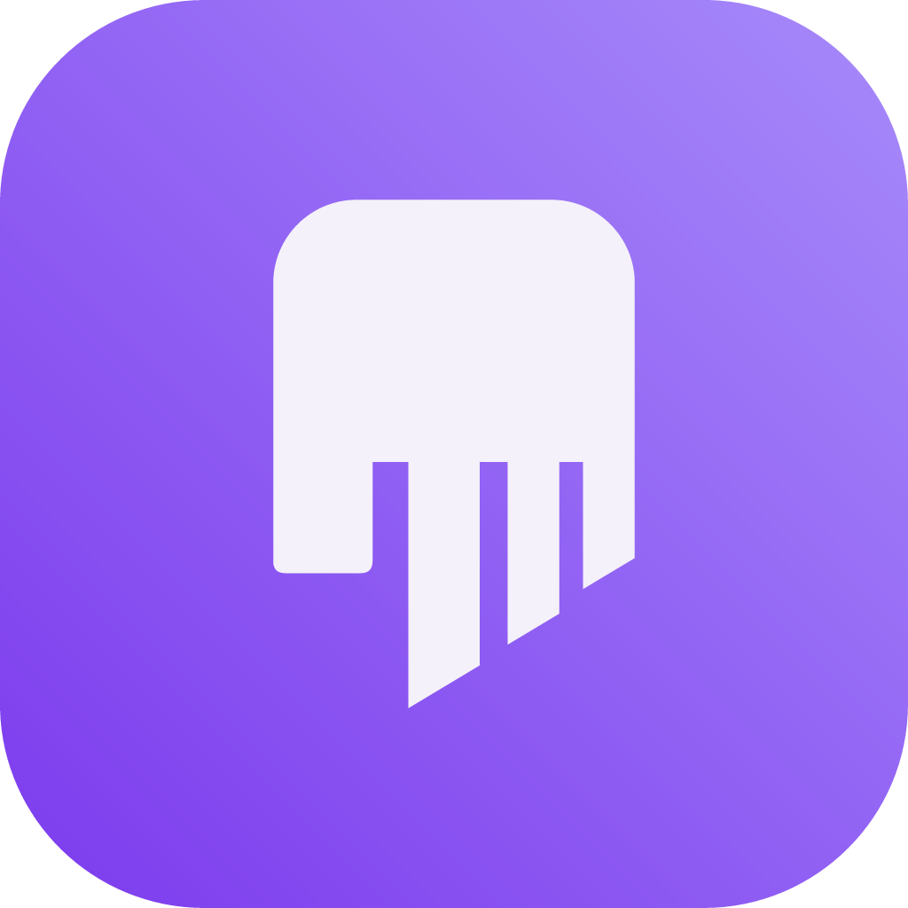
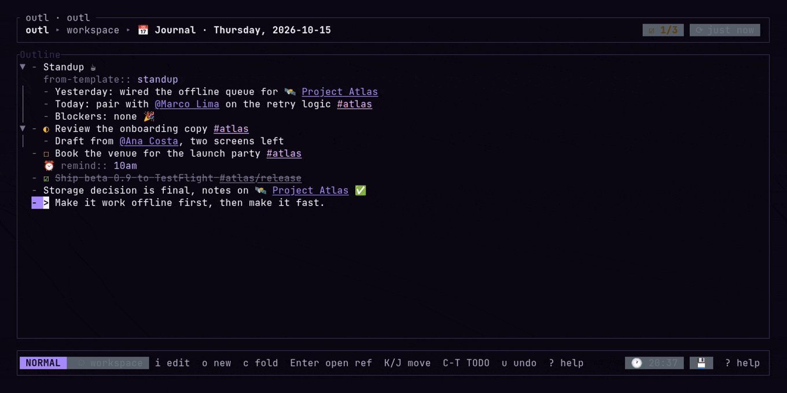
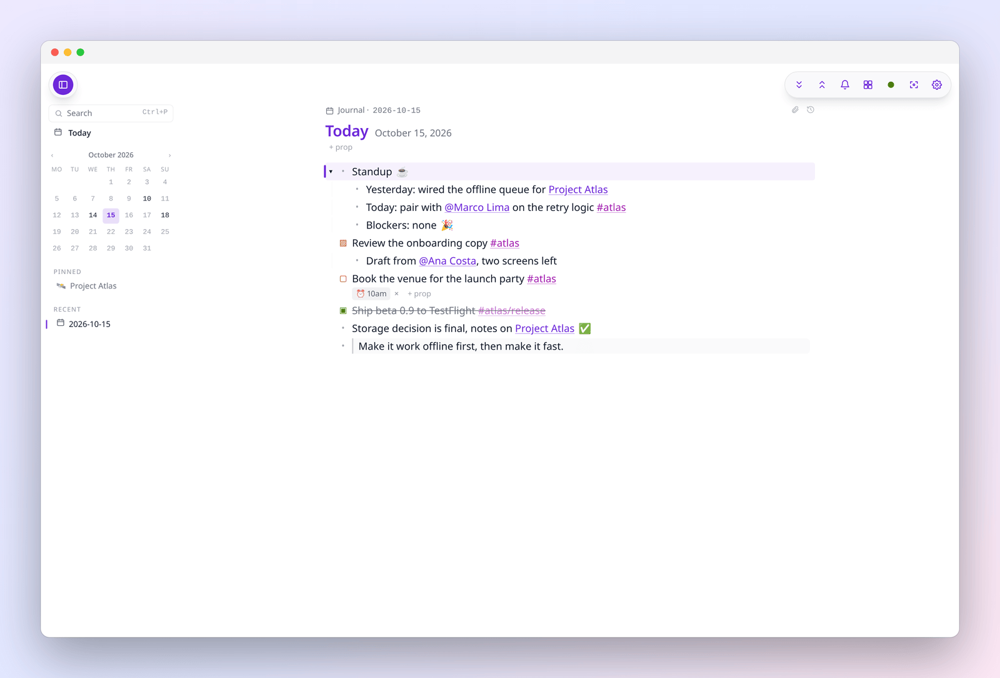
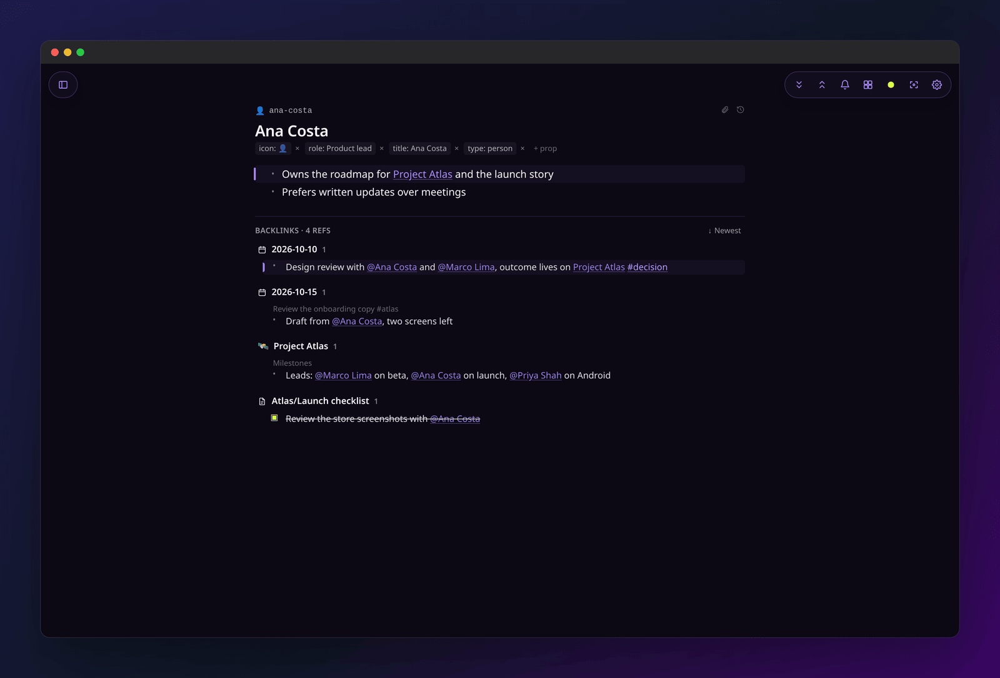
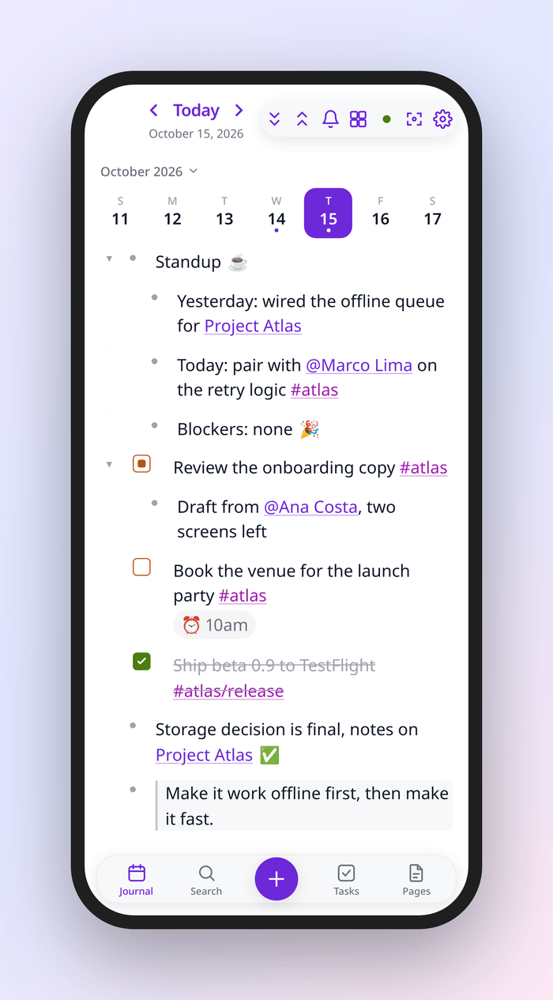

<p align="center">
  
</p>

<h1 align="center">outl</h1>

<p align="center">
  <a href="https://discord.gg/fDDXRtFhA6">
    
  </a>
  <a href="https://github.com/sponsors/avelino">
    
  </a>
</p>

<p align="center">
  Local-first outliner.
  Markdown is the source of truth.
  Sync that doesn't corrupt your tree when two devices edit offline.
</p>

<p align="center">
  
</p>

<p align="center">
  
  
  
</p>

Inspired by [Roam Research](https://roamresearch.com) and [Logseq](https://logseq.com).
Tree CRDT sync ([Kleppmann et al. 2022][paper]), per-device append-only op log, IDs in a sidecar so the `.md` you see is the `.md` you wrote.

- **Why outl?** [outl.app/docs/why-outl.html](https://outl.app/docs/why-outl.html)
- **Sync, done right:** [outl.app/docs/sync.html](https://outl.app/docs/sync.html)
- **CRDT walkthrough:** [outl.app/docs/crdt.html](https://outl.app/docs/crdt.html)

[paper]: https://martin.kleppmann.com/papers/move-op.pdf

## Install

| Client | How |
|---|---|
| **Terminal** (TUI + CLI + MCP), macOS and Linux | `brew tap outlmd/outl https://github.com/outlmd/outl && brew trust outlmd/outl && brew install outl-beta` |
| **Terminal**, Windows | `scoop bucket add outl https://github.com/outlmd/outl && scoop install outl/outl-beta` |
| **Terminal**, Nix | `nix profile add github:outlmd/outl` ([Nix](https://outl.app/docs/nix.html)) |
| **Desktop**, macOS | `brew install --cask outl-desktop-beta` |
| **Desktop**, Linux and Windows | AppImage, `.deb`, `.rpm` and an NSIS installer on every [release](https://github.com/outlmd/outl/releases), for `x86_64` and `aarch64` |
| **iOS** | [TestFlight beta](https://testflight.apple.com/join/P2GdWAMd) |
| **Android** | `outl-android-arm64.apk` on every [release](https://github.com/outlmd/outl/releases) |
| **From source** | `git clone https://github.com/outlmd/outl && cd outl && cargo build --release` |

`outl-beta` is the nightly channel, cut from `main`.
The stable `outl` formula appears with the first stable release.
Both desktop builds are unsigned for now, so macOS and Windows warn on first launch; [Getting started](https://outl.app/docs/getting-started.html#install-the-desktop-app) has the two-line fix for each.

Android is sideload-only for now: it is not on Play, and each release is signed with a fresh key, so a new build means uninstalling the old one first ([#171](https://github.com/outlmd/outl/issues/171)).

The iOS app keeps your notes in its own folder on the phone and syncs peer to peer.
Pair it with your computer by scanning a QR; there is no account and no cloud folder.

- **Every install path, step by step:** [getting started](https://outl.app/docs/getting-started.html)
- **Channels and upgrades:** [homebrew](https://outl.app/docs/homebrew.html), [scoop](https://outl.app/docs/scoop.html)

## Quick start

```bash
outl init ~/notes              # scaffold a workspace
outl --workspace ~/notes       # opens the TUI on today's journal
```

Press `?` for the keymap, `:` for the command palette, `Ctrl+P` to fuzzy-jump, `q q` to quit.
Type `i`, write `met with [[Ana]] about #roadmap`, press `Esc`, move onto `Ana` with `w`, press `Enter`: the page exists and its backlinks are on it.

On the desktop and phone you pick or accept a folder on first launch, and land on the same journal.

Second device:

```bash
outl peer pair                                   # on the device that has your notes
outl peer pair --ticket <ticket>                 # on the other, from an empty folder
outl sync
```

On a phone, scan the QR the desktop shows (**Settings → Sync → Pair a new device…**).
The guide for every pairing combination is [Sync your devices](https://outl.app/docs/sync-devices.html).

- [Getting started](https://outl.app/docs/getting-started.html)
- [Your first week (tutorial)](https://outl.app/docs/tutorial.html)
- [TUI manual](https://outl.app/docs/tui.html), [desktop](https://outl.app/docs/desktop.html), [phone](https://outl.app/docs/mobile.html)
- [Which client does what](https://outl.app/docs/clients.html#which-client-does-what), and the generated [client parity table](https://outl.app/docs/client-parity.html)
- [CLI reference](https://outl.app/docs/cli.html), [MCP](https://outl.app/docs/mcp.html)
- [Markdown dialect](https://outl.app/docs/markdown-format.html), [Shortcuts](https://outl.app/docs/shortcuts.html)
- [Troubleshooting](https://outl.app/docs/troubleshooting.html)

## Get help

- **Something broke:** [troubleshooting](https://outl.app/docs/troubleshooting.html), or run `outl doctor`.
- **Questions and ideas:** [Discord](https://discord.gg/fDDXRtFhA6).
- **Bugs and missing features:** [open an issue](https://github.com/outlmd/outl/issues) with `outl --version`, the client, and what you did.

## Optional: an always-on peer

**You don't need a server.**
Pair your laptop and your phone and they sync directly, P2P.
That's the normal setup.

But P2P converges only when two devices can reach each other, and a laptop shut at 18:00 never overlaps a phone edited at 22:00.
If that's you, a third device that never sleeps closes the gap, on hardware you own.

```bash
docker compose build
outl peer pair --name laptop                                  # on a device that HAS your notes
docker compose run --rm outl peer pair --ticket <ticket>      # the server joins
docker compose up -d
```

Not a server your notes sync *through*: no account, no upload, nobody else's infrastructure holding your graph.
Just one more peer that happens to be awake all the time, holding a full replica of the op log.
Turn it off and your other devices carry on talking to each other.
[Self-hosting guide](https://outl.app/docs/self-hosting.html).

## Coming from Roam, Logseq or Obsidian?

```bash
outl import auto ~/path/to/your/graph ~/notes --dry-run   # measure first, writes nothing
outl import auto ~/path/to/your/graph ~/notes             # then import
```

`auto` detects the source: a Roam JSON backup, a Logseq graph folder, a Logseq DB export, or an Obsidian vault.
Name the format (`roam`, `logseq`, `logseq-db`, `obsidian`) if you prefer.
Logseq's new DB version stores a graph in SQLite; export it with **Export graph → Export EDN file** and import that `.edn` file ([details](docs/import.md#logseq-db-graphs-logseq-db)).

The importers resolve `((uid))` block refs and `{{embed}}`s into real outl block references, keep folded state, and translate each dialect.
Everything touched is counted in the import report, so the dry run measures fidelity against your backup.
A ref whose target is not in the export stays as the source wrote it, `((UID))`, so it remains greppable for manual triage.
A real import refuses a workspace that already has pages, so use a fresh folder.

## Support outl

outl is built by one person, on nights and weekends.
No account, no server holding your notes, nothing to upsell you on.
Sponsors are what turn leftover hours into real, dedicated time.

- **[Sponsor on GitHub](https://github.com/sponsors/avelino)**, from $5 a month, or a one-time coffee
- **$5+**: a vote in the quarterly poll that decides what goes next on the roadmap, your name in the list below and the Sponsor role on [Discord](https://discord.gg/fDDXRtFhA6)
- **$15+**: early access to beta builds and a monthly sponsors-only update
- **Companies**: your logo here and on [outl.app](https://outl.app), from $100 a month

### Supporters

Thank you to everyone keeping outl moving.
Updated once a month.
[Add your name](https://github.com/sponsors/avelino).

<!-- supporters:start -->
<!-- supporters:end -->

## Contributing

- [Developer setup](https://outl.app/docs/development.html)
- [Contributing guide](https://outl.app/docs/contributing.html)
- [Architecture](https://outl.app/docs/architecture.html)
- [Roadmap](https://github.com/users/avelino/projects/2/views/1): where the project is going

## Background reading

The engineering decisions behind outl on [avelino.run](https://avelino.run):

- **[File sync isn't trivial](https://avelino.run/file-sync-isnt-trivial/)**: why concurrent file moves are a distributed-systems problem that Dropbox and Google Drive still get wrong.
- **[From paper to outliner](https://avelino.run/from-paper-to-outliner/)**: the gap between "the CRDT converges" and "the app ships": projections, content-addressable reconciliation, surviving iCloud's lazy materialisation.

## License

[MIT](LICENSE).
